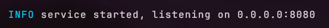
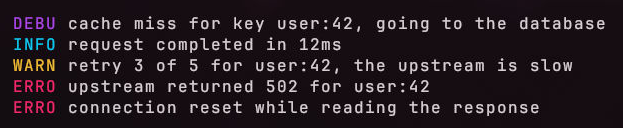
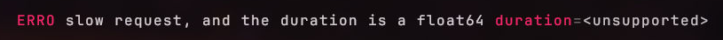
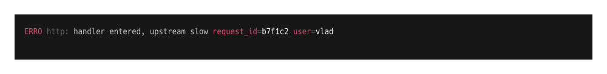
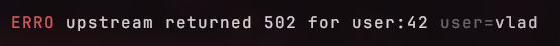
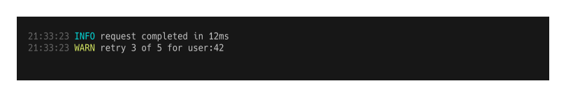

<div align="center">


A console logger for Go built on a fixed 1024-byte buffer. No string building, no
growth, no allocation on the per-line path.

<p align="center">
  
  
  
  <a href="https://pkg.go.dev/github.com/itsvlxd/stacklog"></a>
</p>

</div>

`stacklog` writes one line per call into a fixed, pre-allocated buffer and flushes
it in a single write. Values are formatted directly into the buffer instead of
being converted to strings first.

The API is deliberately small: a logger, a config, key/value pairs, a prefix,
colours, and padding. There is no reflection, no field marshalling, and no
dependency outside the standard library.

## Features

- Fixed 1024-byte buffer, no growth, no reallocation
- Zero allocations on the per-line path
- Leveled logging: debug, info, warn, error, fatal
- Key/value pairs written as `key=value`
- Per-level colours and per-pair styles
- Named style presets, with a single component override standing against the preset
- Colour index, 256-colour, truecolour hex, and background colours
- Padding around a line, including coloured blocks
- Optional prefix and timestamp
- Configurable writer — file, buffer, `io.Discard`
- Write errors returned, including short writes

## Installation

```bash
go get github.com/itsvlxd/stacklog
```

## Getting started

The images below are terminal captures produced by `go run ./example/readme`, which
runs these examples as one session from a single service.

### Simple logging example

```go
package main

import "github.com/itsvlxd/stacklog"

func main() {
	logger := stacklog.CreateLogger(stacklog.Config{})

	logger.Info("service started, listening on 0.0.0.0:8080")
}
```



> By default the logger writes to `os.Stdout`.

### Leveled logging

```go
logger := stacklog.CreateLogger(stacklog.Config{})

logger.Debug("cache miss for key user:42, going to the database")
logger.Info("request completed in 12ms")
logger.Warn("retry 3 of 5 for user:42, the upstream is slow")
logger.Error("upstream returned 502 for user:42")
logger.Error("connection reset while reading the response")
```



Levels are: `DebugLevel`, `InfoLevel`, `WarnLevel`, `ErrorLevel`, `FatalLevel`.

There is no global level filter. Every call writes. If you want filtering, decide
it before you call the logger.

### Key/value context

Arguments are read in pairs — key, value, key, value — and rendered as
`key=value`.

```go
kv := logger.WithParams("request_id", "b7f1c2", "user", "vlad")

kv.Error("upstream returned 502, retried 3 times")
```


Supported value types: `int`, `int64`, `uint`, `uint64`, `bool`, `string`.
Anything else is written as `<unsupported>`.

```go
kv.WithParams("duration", 1.44).Error("slow request, and the duration is a float64")
```



> An odd number of arguments is not validated. The last value is written with no
> key. `float64`, `time.Duration` and `error` are the common types missing today.

### Prefix

```go
prefixed := kv.WithPrefix("http")

prefixed.Error("handler entered, upstream slow")
```



`WithParams`, `WithPrefix` and `WithWriter` return new loggers. The original is
never modified, so a base logger can be shared and specialised per call site.

> Because the copy takes its own `Config`, a style change made after the copy does
> not reach the copy. Set the style first, then derive the logger.

### Colours and styles

Three accepted forms:

```go
stacklog.NewStyle().Foreground(242)                  // 256-colour index
stacklog.NewStyle().Foreground(stacklog.ColorRGB{R: 171, G: 205, B: 239})
stacklog.NewStyle().Foreground("#D75F5F")            // truecolour hex
stacklog.NewStyle().Background(stacklog.ColorReset)
```

A style can be set through `Config` at creation, or on the logger after. A
component left as the zero value falls back to the named preset, which is the
package palette when no preset is given.

Per-level and per-pair styles:

```go
styled := stacklog.CreateLogger(stacklog.Config{})

styled.Config.Style.Level[3] = stacklog.NewStyle().Foreground("#D75F5F")

styled.Config.Style.Params[3] = stacklog.ParamsStyle{
	Param: stacklog.NewStyle().Foreground(242),
	Equal: stacklog.NewStyle().Foreground(242),
	Value: stacklog.NewStyle().Foreground(15),
}

styled.WithParams("user", "vlad").Error("upstream returned 502 for user:42")
```



> The key and the value are in different colours here, which is what the
> `ParamsStyle` block controls.

> `HexToRGB` accepts only `#RRGGBB`. Any other input returns white. `Color(0)` is
> black, not a sentinel — the "not set" state is carried separately, so a style
> that sets nothing emits no escape sequence.

### Presets

A preset is a complete style: colours, padding, and the level labels. Pick one by
name, and override a single component on top of it.

```go
logger := stacklog.CreateLogger(stacklog.Config{
	Timestamp: true,
	Style: stacklog.Style{
		Preset: stacklog.PresetBadge,
	},
})

logger.Error("upstream returned 502 for user:42")
```

Four names, and an unknown name resolves to `PresetDefault`. Every preset carries a palette.

| Preset | What it is |
|---|---|
| `PresetDefault` | grey timestamp and prefix, coloured level text, four-letter labels |
| `PresetMuted` | low-chroma palette, full-word labels. For long-running services and for output that ends up in a file |
| `PresetBadge` | the level as a block — background colour, white text, padding inside the block, three-letter labels |
| `PresetHighContrast` | bright colours for legibility, four-letter labels |

`NoColors` is a flag, not a preset. It applies to any preset and writes no escape
sequence at all:

```go
logger := stacklog.CreateLogger(stacklog.Config{
	Style: stacklog.Style{Preset: stacklog.PresetMuted, NoColors: true},
})

logger.Warn("labels from the preset, no colour codes, no reset codes")
```

The flag wins over an explicit component. A caller who sets a colour and sets
`NoColors` gets no colour. That is the precedence, and `TestNoColorsWinsOverAnExplicitStyle`
asserts it so it cannot change silently.

Padding is not affected by the flag. `Left` and `Right` exist to sit inside a
coloured block, and with no colour there is no block, so they become plain
whitespace. That is an open decision, not a solved one.

A component you set yourself wins. The preset fills only what is left empty, so
one override changes one component and the rest of the preset stands.

```go
styled := stacklog.CreateLogger(stacklog.Config{
	Style: stacklog.Style{
		Preset: stacklog.PresetBadge,
		Level: [stacklog.MaxLevel]stacklog.CompStyle{
			stacklog.NewStyle().Foreground("#FFFFFF").Background("#D75F5F"),
		},
		LevelPrefix: [stacklog.MaxLevel]string{"!!"},
	},
})

styled.Error("only level 0 is the override, the rest comes from the preset")
```

The logger prefix is styled through `Style.Prefix`. It used to be hardcoded, so a
preset could not reach it.

> A preset cannot express an intentionally empty label, because an empty string
> means "not set". Same class of problem as the colour sentinel.

> `PresetHighContrast` uses indices 17 and above only. Indices 9 to 16 are broken
> in `writeColor`, so a bright palette cannot use the natural range yet.

> The `PresetPlain` labels are not the same length, so the message column shifts.
> Accepted here: a plain line is not meant to be aligned.

> `ParamsStyle` is guarded as a whole triple, not as `Param`, `Equal` and `Value`
> separately. Setting one of them means the other two stay empty and emit nothing.

### Padding

`Top`, `Left`, `Bottom`, `Right`. Left and Right are spaces written inside the
coloured block, so a badge with a background extends over them.

```go
badge := stacklog.CreateLogger(stacklog.Config{})

badge.Config.Style.Level[3] = stacklog.NewStyle().
	Background("#D75F5F").
	Foreground(15).
	Padding(stacklog.Padding{Top: 1, Left: 1, Right: 1, Bottom: 1})

badge.Error("connection reset while reading the response")
```


> Top is honoured only for the first component on the line. Bottom is never
> emitted mid-line — it is accumulated as the maximum across the line and flushed
> after the line ends.

### Timestamp

```go
ts := stacklog.CreateLogger(stacklog.Config{
	Timestamp:  true,
	TimeFormat: "15:04:05",
})

ts.Info("request completed in 12ms")
```



`TimeFormat` is a Go reference-time layout. When it is empty, `time.DateTime` is
used.

> With a timestamp enabled, the timestamp is the first component, so `Top` padding
> has to be requested on the timestamp style. Setting it on the level style does
> nothing, because the line-start state is already consumed.

### Writing to a file

```go
package main

import (
	"os"

	"github.com/itsvlxd/stacklog"
)

func main() {
	base := stacklog.CreateLogger(stacklog.Config{})

	f, err := os.OpenFile("readme-example.log", os.O_CREATE|os.O_WRONLY|os.O_TRUNC, 0o600)
	if err != nil {
		os.Stderr.WriteString("could not open the log file: " + err.Error() + "\n")
		return
	}
	defer f.Close()

	logger := base.WithWriter(f)

	if err := logger.Error("service started, listening on 0.0.0.0:8080"); err != nil {
		os.Stderr.WriteString("write failed: " + err.Error() + "\n")
	}
}
```


Contents of `readme-example.log`:

```text

\x1b[31mERRO\x1b[31m\x1b[0m service started, listening on 0.0.0.0:8080

```

> There is no terminal detection. Colours are always written, so a log file
> contains ANSI codes. If you want plain output, that is a feature to add.

### Handling write errors

`Debug`, `Info`, `Warn` and `Error` return the write error. A short write is
returned as `ErrShortWrite`, because by the `io.Writer` contract a short write is
a failure, not a partial success.

```go
if err := logger.Error("upstream returned 502 for user:42"); err != nil {
	os.Stderr.WriteString("write failed: " + err.Error() + "\n")
}
```

```text
write failed: stacklog: short write
```

> No capture for this section yet. Add `assets/handling-write-errors.png` and it
> will render here.

> The buffer is reset after a failed write, so one failure does not corrupt the
> following lines. A short write also means the padding never reaches the writer,
> because the flush failed before it got there.

### Fatal

```go
logger.Fatal("shutting down, the port is still in use")
```


`Fatal` writes the line and calls `os.Exit(1)`. It does not return an error,
because it never returns. Deferred functions do not run, and a buffered writer is
not flushed.

## Benchmarks

```bash
go test -bench . -benchmem
```

Both loggers writing to `io.Discard`, same shape of work. Measured on an
i9-12900KS with Go 1.27.3.

```text
BenchmarkStackLog    104.2 ns/op    0 B/op    0 allocs/op
BenchmarkSlog        348.6 ns/op    0 B/op    0 allocs/op
```

`stacklog` writes ANSI colour; `log/slog`'s text handler does not, so this is not
identical work. The `allocs/op` result is the stable part — time depends on the
machine.

`CreateLogger` allocates, and so does `WithParams`. The per-line path does not.
