<div align="center">


A console logger for Go built on a fixed 1024-byte buffer. No string building, no
growth, no allocation on the per-line path.

<p align="center">
  
  
  
  <a href="https://pkg.go.dev/github.com/itsvlxd/stacklog"></a>
</p>

</div>

`stacklog` writes one line per call into a fixed, pre-allocated buffer and flushes
it in a single write. Values are formatted directly into the buffer instead of
being converted to strings first.

The API is deliberately small: a logger, a config, key/value pairs, a prefix,
colours, and padding. There is no reflection, no field marshalling, and no
dependency outside the standard library.

## Features

- Fixed 1024-byte buffer, no growth, no reallocation
- A line longer than the content area is cut and marked with `...`, and it keeps its
  terminator so two log calls never merge
- Zero allocations on the per-line path
- Leveled logging: debug, info, warn, error, fatal
- Level filtering through `Config.MinLevel`, applied before the line is built
- Key/value pairs written as `key=value`
- Per-level colours and per-pair styles
- Named style presets, with a single component override standing against the preset
- Colour index, 256-colour, truecolour hex, and background colours
- Padding around a line, including coloured blocks
- Optional prefix and timestamp
- Configurable writer — file, buffer, `io.Discard`
- JSON Lines output through `Config.Format`, with colours suppressed and an exported `Entry`
- Write errors returned, including short writes

## Installation

```bash
go get github.com/itsvlxd/stacklog
```

## Getting started

The images below are animated terminal captures, regenerated by `./example/capture.sh`,
which runs the showcase program once per feature and records each section on its own tape.
The program is `example/main.go`, `go run ./example -list` prints the section names, and the
capture script is driven by that list — a feature cannot be captured unless it exists,
and it cannot be dropped without the script saying so.

Captures are recorded with a pinned theme, `Builtin Dark`. A terminal recorder paints the
base ANSI colours from its own theme rather than from your terminal, so the colours in
these images are one rendering of what the package emits, not a promise about your palette.

A capture is a GIF, and a GIF carries an indexed palette of 256 colours. A truecolour value
the package emits is rounded to the nearest entry that palette holds — in the *Colours and
styles* capture, `#D75F5F` is recorded as `#DA6053`. That is a limit of the recording, not of
the package.

### Simple logging example

```go
package main

import "github.com/itsvlxd/stacklog"

func main() {
	logger := stacklog.CreateLogger(stacklog.Config{})

	logger.Info("service started, listening on 0.0.0.0:8080")
}
```

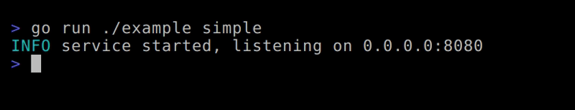

> By default the logger writes to `os.Stdout`.

### Leveled logging

```go
logger := stacklog.CreateLogger(stacklog.Config{})

logger.Debug("cache miss for key user:42, going to the database")
logger.Info("request completed in 12ms")
logger.Warn("retry 3 of 5 for user:42, the upstream is slow")
logger.Error("upstream returned 502 for user:42")
logger.Error("connection reset while reading the response")
```

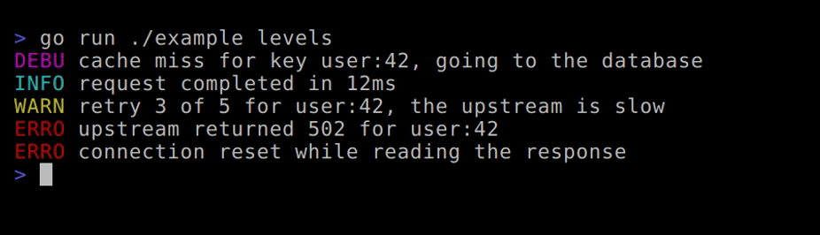

Levels are: `DebugLevel`, `InfoLevel`, `WarnLevel`, `ErrorLevel`, `FatalLevel`. They
ascend in severity, which is what makes a filter worth having.

### Level filter

`Config.MinLevel` drops every call below it, before anything is written into the
buffer. The zero value is `DebugLevel`, so a `Config` that says nothing about levels
writes everything it always wrote.

```go
logger := stacklog.CreateLogger(stacklog.Config{MinLevel: stacklog.WarnLevel})

logger.Debug("cache miss for key user:42")  // nothing written
logger.Warn("retry 3 of 5 for user:42")     // written
logger.Error("upstream returned 502")       // written
```

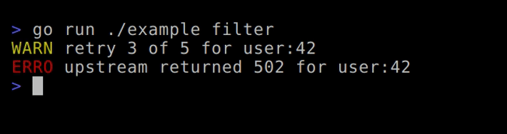

A filter writes its own level and everything more severe, so it cannot hide a worse
problem than the problem it keeps. `Fatal` sits above the others and still exits: the
only way to silence it is to set `MinLevel` past `FatalLevel`, which is a decision made
on purpose rather than one that happens to you.

The filter lives in `Config`, and `Config` is copied when a logger is derived. Set it
where the logger is made. A derived logger inherits the filter; changing `MinLevel` on
the base after deriving does not reach the copy. That is the same ordering rule the
styles already follow, and `TestFilterSetAfterDerivingDoesNotReachTheCopy` keeps it
from drifting.

`Enabled` is the comparison the logger makes internally, exposed so a caller can skip
building a message that would have been thrown away:

```go
if logger.Enabled(stacklog.DebugLevel) {
	logger.Debug("state: " + dumpState())
}
```

A filtered call costs under a nanosecond — 0.91 ns across ten runs of 3,000,000 calls — and
allocates nothing. A line that is actually built costs about 62 ns to render, before the write.

### Key/value context

Arguments are read in pairs — key, value, key, value — and rendered as
`key=value`.

```go
kv := logger.WithParams("request_id", "b7f1c2", "user", "vlad")

kv.Error("upstream returned 502, retried 3 times")
```

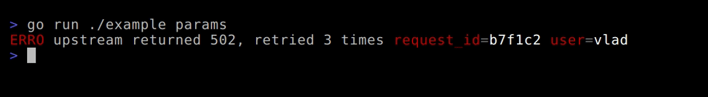

Supported value types: every `int` and `uint` width, `float32`, `float64`, `bool`,
`string`, `error`, and `time.Duration`. A `time.Duration` is written as nanoseconds,
because that is what it is — an `int64` counted in nanoseconds — so
`1500 * time.Microsecond` writes `1500000`. `float32` is written in the shortest form
that reads back as the same `float32`, so `float32(1.1)` writes `1.1` and not
`1.100000023841858`. A nil value writes `<nil>`. Anything else is written as
`<unsupported>`.

```go
kv.WithParams("when", time.Now()).Error("a time.Time is not a supported value")
```

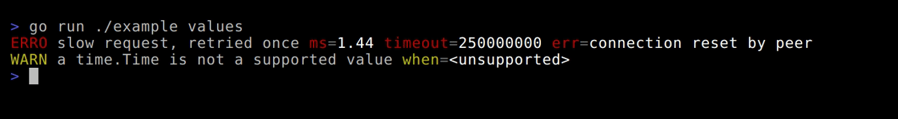

> An odd number of arguments is not validated. The last value is written with no
> key.

### Prefix

```go
prefixed := kv.WithPrefix("http")

prefixed.Error("handler entered, upstream slow")
```

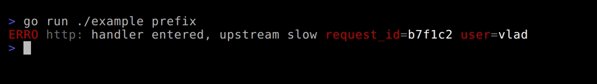

`WithParams`, `WithPrefix` and `WithWriter` return new loggers. The original is
never modified, so a base logger can be shared and specialised per call site.

> Each derived logger owns its own buffer, so deriving one per goroutine is the
> safe pattern. Calling the same logger from two goroutines is not safe, and no
> lock guards a logger. A derived logger shares its writer, so a writer used by
> several loggers has to be safe for concurrent use in its own right: `os.Stdout`
> is, a `bytes.Buffer` is not.

> Because the copy takes its own `Config`, a style change made after the copy does
> not reach the copy. Set the style first, then derive the logger.

### Colours and styles

Three accepted forms:

```go
stacklog.NewStyle().Foreground(242)                  // 256-colour index
stacklog.NewStyle().Foreground(stacklog.ColorRGB{R: 171, G: 205, B: 239})
stacklog.NewStyle().Foreground("#D75F5F")            // truecolour hex
stacklog.NewStyle().Background(stacklog.ColorReset)
```

A style can be set through `Config` at creation, or on the logger after. A
component left as the zero value falls back to the named preset, which is the
package palette when no preset is given.

Per-level and per-pair styles:

```go
styled := stacklog.CreateLogger(stacklog.Config{})

styled.Config.Style.Level[stacklog.ErrorLevel] = stacklog.NewStyle().Foreground("#D75F5F")

styled.Config.Style.Params[stacklog.ErrorLevel] = stacklog.ParamsStyle{
	Param: stacklog.NewStyle().Foreground(242),
	Equal: stacklog.NewStyle().Foreground(242),
	Value: stacklog.NewStyle().Foreground(15),
}

styled.WithParams("user", "vlad").Error("upstream returned 502 for user:42")
```

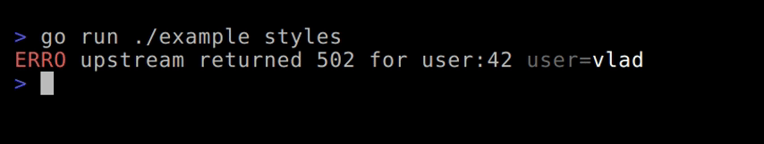

> The key and the value are in different colours here, which is what the
> `ParamsStyle` block controls.

> `HexToRGB` accepts only `#RRGGBB`. Any other input returns white. `Color(0)` is
> black, not a sentinel — the "not set" state is carried separately, so a style
> that sets nothing emits no escape sequence.

### Presets

A preset is a complete style: colours, padding, and the level labels. Pick one by
name, and override a single component on top of it.

```go
logger := stacklog.CreateLogger(stacklog.Config{
	Timestamp: true,
	Style: stacklog.Style{
		Preset: stacklog.PresetBadge,
	},
})

logger.Error("upstream returned 502 for user:42")
```

Four names, and an unknown name resolves to `PresetDefault`. Every preset carries a palette.

| Preset | What it is |
|---|---|
| `PresetDefault` | grey timestamp and prefix, coloured level text, four-letter labels |
| `PresetMuted` | low-chroma palette, full-word labels. For long-running services and for output that ends up in a file |
| `PresetBadge` | the level as a block — background colour, white text, padding inside the block, three-letter labels |
| `PresetHighContrast` | bright colours for legibility, four-letter labels |

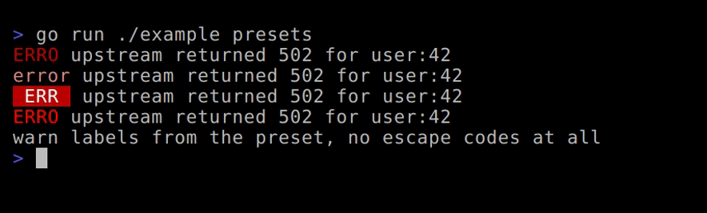

`NoColors` is a flag, not a preset. It applies to any preset and writes no escape
sequence at all:

```go
logger := stacklog.CreateLogger(stacklog.Config{
	Style: stacklog.Style{Preset: stacklog.PresetMuted, NoColors: true},
})

logger.Warn("labels from the preset, no colour codes, no reset codes")
```

The flag wins over an explicit component. A caller who sets a colour and sets
`NoColors` gets no colour. That is the precedence, and `TestNoColorsWinsOverAnExplicitStyle`
asserts it so it cannot change silently.

Padding is not affected by the flag. `Left` and `Right` exist to sit inside a
coloured block, and with no colour there is no block, so they become plain
whitespace. That is an open decision, not a solved one.

A component you set yourself wins. The preset fills only what is left empty, so
one override changes one component and the rest of the preset stands.

```go
styled := stacklog.CreateLogger(stacklog.Config{
	Style: stacklog.Style{
		Preset: stacklog.PresetBadge,
		Level: [stacklog.MaxLevel]stacklog.CompStyle{
			stacklog.NewStyle().Foreground("#FFFFFF").Background("#D75F5F"),
		},
		LevelPrefix: [stacklog.MaxLevel]string{"!!"},
	},
})

styled.Error("only level 0 is the override, the rest comes from the preset")
```

The logger prefix is styled through `Style.Prefix`. It used to be hardcoded, so a
preset could not reach it.

> A preset cannot express an intentionally empty label, because an empty string
> means "not set". Same class of problem as the colour sentinel.

> Indices 8 to 15 take the bright ANSI range — 90 to 97 for the foreground and
> 100 to 107 for the background — and 16 and above are written through the
> 256-colour form. `PresetHighContrast` chooses from the 256-colour range.

> The `PresetMuted` labels are full words — `debug`, `info`, `warn`, `error`,
> `fatal` — so they are not the same length and the message column shifts between
> levels. Accepted here: a muted line is not meant to be aligned.

> `ParamsStyle` is guarded as a whole triple, not as `Param`, `Equal` and `Value`
> separately. Setting one of them means the other two stay empty and emit nothing.

### Padding

`Top`, `Left`, `Bottom`, `Right`. Left and Right are spaces written inside the
coloured block, so a badge with a background extends over them.

```go
badge := stacklog.CreateLogger(stacklog.Config{})

badge.Config.Style.Level[stacklog.ErrorLevel] = stacklog.NewStyle().
	Background("#D75F5F").
	Foreground(15).
	Padding(stacklog.Padding{Top: 1, Left: 1, Right: 1, Bottom: 1})

badge.Error("connection reset while reading the response")
```

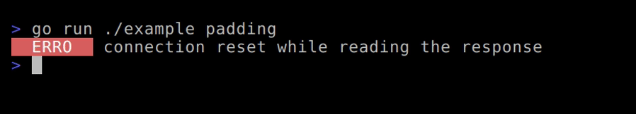

> Top is honoured only for the first component on the line. Bottom is never
> emitted mid-line — it is accumulated as the maximum across the line and flushed
> after the line ends.

### Timestamp

```go
ts := stacklog.CreateLogger(stacklog.Config{
	Timestamp:  true,
	TimeFormat: "15:04:05",
})

ts.Info("request completed in 12ms")
```

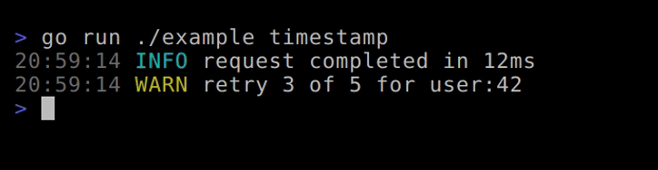

`TimeFormat` is a Go reference-time layout. When it is empty, `time.DateTime` is
used.

> With a timestamp enabled, the timestamp is the first component, so `Top` padding
> has to be requested on the timestamp style. Setting it on the level style does
> nothing, because the line-start state is already consumed.

### Writing to a file

```go
package main

import (
	"os"

	"github.com/itsvlxd/stacklog"
)

func main() {
	base := stacklog.CreateLogger(stacklog.Config{})

	f, err := os.OpenFile("readme-example.log", os.O_CREATE|os.O_WRONLY|os.O_TRUNC, 0o600)
	if err != nil {
		os.Stderr.WriteString("could not open the log file: " + err.Error() + "\n")
		return
	}
	defer f.Close()

	logger := base.WithWriter(f)

	if err := logger.Error("service started, listening on 0.0.0.0:8080"); err != nil {
		os.Stderr.WriteString("write failed: " + err.Error() + "\n")
	}
}
```

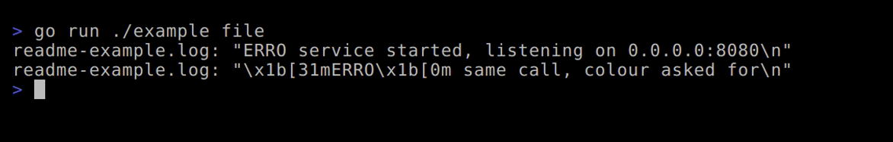

Contents of `readme-example.log`, quoted by the showcase so the escape codes are
visible rather than interpreted:

```text
readme-example.log: "\x1b[31mERRO\x1b[0m service started, listening on 0.0.0.0:8080\n"
```

> There is no terminal detection. Colours are written unless `Style.NoColors` is
> set, so a log file contains ANSI codes by default. For plain output, set
> `NoColors`.

### Handling write errors

`Debug`, `Info`, `Warn` and `Error` return the write error. A short write is
returned as `ErrShortWrite`, because by the `io.Writer` contract a short write is
a failure, not a partial success.

```go
if err := logger.Error("upstream returned 502 for user:42"); err != nil {
	os.Stderr.WriteString("write failed: " + err.Error() + "\n")
}
```

```text
write failed: stacklog: short write
```

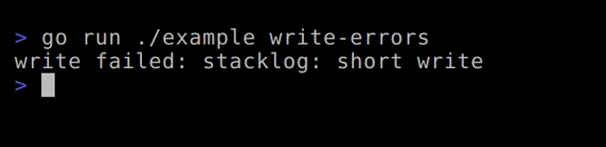

> The buffer is reset after a failed write, so one failure does not corrupt the
> following lines. A short write also means the padding never reaches the writer,
> because the flush failed before it got there.

### JSON output

`Config.Format` switches what one call writes. `FormatJSON` emits a single JSON object per
call, newline terminated, so the line a parser reads is the line the logger built. The zero
value writes text, and an unknown format name resolves to text, so nothing that works today
changes unless you ask for it.

```go
logger := stacklog.CreateLogger(stacklog.Config{Format: stacklog.FormatJSON})

logger.WithPrefix("http").WithParams("user", "vlad", "ms", 12.4).Error("upstream 502")
```

```text
{"level":"error","prefix":"http","msg":"upstream 502","params":{"user":"vlad","ms":12.4}}
```

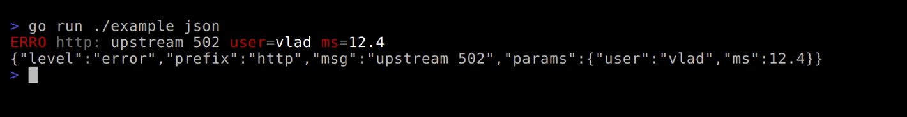

Above it, in the same showcase section, the same call in text mode: `ERRO http: upstream 502
user=vlad ms=12.4`. Adding `Timestamp: true` puts a `"time"` field first, in RFC3339 when
`TimeFormat` is left empty — `"time":"2026-11-11T15:46:52+02:00"` — because a JSON timestamp is
meant to be parsed and `"2026-11-11 15:46:52"` carries no offset.

Colours are off because escape codes inside a JSON string are noise to a parser, not because
you asked. `Style.NoColors` is what does it, and `Config.Style.NoColors` reads back as `true`
on a JSON logger. Padding is inert, and so is `Style.LevelPrefix`: in JSON the level is a field
with five fixed values, so a label like `DEBU` or `!!` would either duplicate it or replace it
with something a parser cannot match on.

The shape is exported rather than implied, which is the point of the mode:

```go
var e stacklog.Entry

if err := json.Unmarshal(line, &e); err != nil {
	return err
}

fmt.Println(e.Level, e.Msg, e.Params["user"], e.Truncated)
```

Types keep their JSON forms. A number is a number, a bool is a bool, a duration is the
nanoseconds it already is in text mode, a `nil` interface is `null`, and an error is the string
from `Error()`. A value the package cannot render is the same `<unsupported>` token text mode
writes — kept distinct from `null` so "could not render this" is not confused with "this is
nil". Keys that are not strings keep their text-mode rendering inside quotes, so
`WithParams(1, "x")` writes `"1":"x"`.

A line too big for the buffer is cut where a cut cannot break it. The message is the field
that gives way: cut inside its own string, ends with `...`, and the object gains
`"truncated":true`. A key/value pair that will not fit is not written at all — never half a
pair, never a dangling `"key":`. Content stops at 1004 bytes in JSON mode against 1020 in text
mode, because the tail that closes an object has to be reserved rather than hoped for.

### Fatal

```go
logger.Fatal("shutting down, the port is still in use")
```

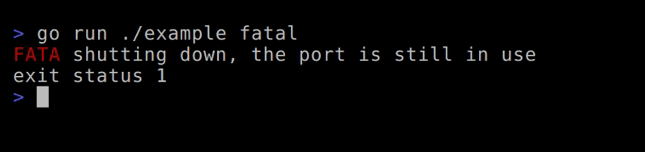

`Fatal` writes the line, flushes the writer if it can be flushed, then calls
`os.Exit(1)`. It does not return an error, because it never returns. A write failure
is reported to `os.Stderr` on a best-effort basis. Deferred functions do not run,
which is why the flush happens here instead of being left to your `defer`.

### Throughput and buffering

A log line has two costs and only one of them is yours to reduce. End to end, 500,000 lines of
the shape this package is used at — a level label, a prefix, two key/value pairs, 137 bytes
written — on the same machine as the benchmarks below:

| writer | ns per line | lines per second |
|---|---|---|
| one syscall per line, straight to a file | 453 | 2.2M |
| `bufio.Writer` at 256 KB, coloured text | 193 | 5.2M |
| the same buffered, `NoColors` set | 114 | 8.8M |
| the same buffered, `FormatJSON` | 148 | 6.8M |
| coloured text buffered, `WithParams` called per line | 564 | 1.8M |

Building the line is about 66 ns of that. Everything after it is the write, and a buffered
writer is the whole difference — 453 ns per call becomes 193 ns. `WithWriter` already takes one:

```go
bw := bufio.NewWriterSize(f, 256*1024)
defer bw.Flush()

logger := stacklog.CreateLogger(stacklog.Config{}).WithWriter(bw)
```

The last row is the trap, and it is the one a caller walks into by instinct. `WithParams` returns
a new logger, and a new logger owns a new 1024-byte buffer, so calling it on every line builds a
buffer per line: 564 ns against 193 ns for identical output. Derive once, reuse it.

Three consequences, each one a change to what the logger promises.

- **Errors move to the flush.** `logger.Error(...)` returns nil once the bytes are
  buffered. The real failure surfaces at `Flush`, and only if you check it.
- **Decide the latency you are accepting.** Buffered output leaves when the buffer
  fills, so a quiet service can hold its last lines for a long time. If that matters,
  flush on a timer as well as on size — zap defaults to 256 KB and 30 seconds,
  whichever comes first, and that interval is your worst-case visibility delay.
- **`bufio.Writer` is not safe for concurrent use.** A derived logger shares its
  writer, so one buffered writer reached from loggers in eight goroutines is a data
  race. One buffered writer per goroutine, or lock it yourself.

This package builds into its own fixed buffer and hands the bytes to whatever writer
you supply. It does not hold a write buffer for you: a logger owning a heap-allocated
buffer contradicts the fixed per-line buffer the package exists to provide.

## Benchmarks

```bash
go test -bench . -benchmem
```

Measured on an i9-12900KS, 24 logical processors, Go 1.27.3, on 2026-11-11. Ten counts of
3,000,000 iterations each. The range column is the part worth reading: a difference inside that
range is not a difference.

| benchmark | median | range | what it measures |
|---|---|---|---|
| `RenderPath` | 61.7 ns | 59.8–66.0 | a coloured line built, never flushed |
| `ErrorToDiscardText` | 66.1 ns | 65.6–79.5 | the same call end to end, to `io.Discard` |
| `ErrorToDiscardTextNoColors` | 40.0 ns | 39.4–42.3 | that call with the escapes suppressed |
| `ErrorToDiscardJSON` | 43.9 ns | 43.3–45.1 | JSON mode, two-character message |
| `ErrorToDiscardTextLong` | 122.0 ns | 119.3–131.3 | a realistic line, coloured text |
| `ErrorToDiscardJSONLong` | 110.4 ns | 108.9–116.4 | the same realistic line, JSON |
| `FilteredCall` | 0.91 ns | 0.81–1.75 | a call `MinLevel` drops |
| `SlogToDiscard` | 348.4 ns | 345.0–364.4 | `log/slog` text handler, same writer |

Every row is `0 B/op` and `0 allocs/op`. That is the claim that travels between machines. The
nanoseconds belong to this one.

**`log/slog` is compared fairly now.** `RenderPath` against `SlogToDiscard` was always the wrong
shape — one builds a line and never flushes, the other is a complete call. The head to head is
`ErrorToDiscardText` against `SlogToDiscard`: the same call, the same discarded writer. 66.1 ns
against 348.4 ns, roughly five times faster, neither allocating.

**What colour costs.** The same line with `NoColors` set is 40.0 ns against 66.1 ns. Escapes are
about 26 ns of a 66 ns line, which means 40% of building a coloured line is emitting colour. Any
further optimisation here should start from that number rather than from a hunch.

**Read the long-line pair, not the short one.** At a two-character message there is no run of
ordinary text to copy in bulk, so JSON looks as cheap as plain text and the escaping never shows
up. With the message length the package is used at — `upstream returned 502 for user:42` with
`user=vlad` and `ms=12.4` — a JSON line is 110.4 ns against 122.0 ns for the coloured text line.

Two changes since v1.4.0 shipped, each measured against the same baseline in the same sitting:

| change | before | after |
|---|---|---|
| each escape assembled in a stack array and copied once, instead of a bounds-checked write per byte | 142.7 ns | 121.0 ns — coloured text, long line |
| runs of ordinary text copied in bulk by the JSON escape writer | 182.5 ns | 109.8 ns — JSON, long line |

The second one decided which format is cheaper. JSON mode used to cost 29% more than a coloured
text line for the same content. It now costs 9% less. The escaping was the entire difference.

`RenderPath` measures 61.7 ns today against 64.6 ns when this section last said anything about
it: fewer escape bytes per component, same colours, same order.

What is still on the table is compiling each style's escapes once per logger instead of per line.
That is the remaining prize, and it collides with `Config.Style.Level[ErrorLevel]` being settable
after `CreateLogger` — which the README documents as the supported way to reach a component. That
is an API decision rather than an optimisation, so it is not taken quietly inside a `perf` commit.

`CreateLogger` allocates, and so does `WithParams`. The per-line path does not.
