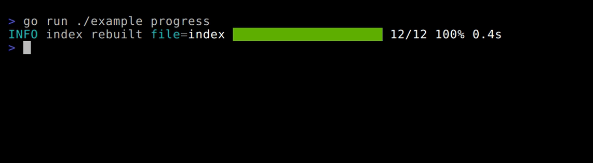

<div align="center">


A console logger for Go built on a fixed 1024-byte buffer. No string building, no
growth, no allocation on the per-line path.

<p align="center">
  
  
  
  <a href="https://pkg.go.dev/github.com/itsvlxd/stacklog"></a>
</p>

</div>

`stacklog` writes one line per call into a fixed, pre-allocated buffer and flushes it in a single write.
Values are formatted straight into the buffer instead of being converted to strings first. No reflection,
no field marshalling, no dependency outside the standard library.

## Install

`go get`, one line, standard library only.

```bash
go get github.com/itsvlxd/stacklog
```

Requires Go 1.27 or newer.

## Quick start

A logger from a config, one call per line, `os.Stdout` unless you say otherwise.

```go
package main

import "github.com/itsvlxd/stacklog"

func main() {
	logger := stacklog.CreateLogger(stacklog.Config{})

	logger.Info("service started, listening on 0.0.0.0:8080")
}
```


Every image in this README is a terminal capture of the program running —
[how they are made](#how-these-captures-are-made).

## Levels and filtering

Five levels, ascending, and a filter that drops everything below a point before a line is built.

```go
logger.Debug("cache miss for key user:42, going to the database")
logger.Info("request completed in 12ms")
logger.Warn("retry 3 of 5 for user:42, the upstream is slow")
logger.Error("upstream returned 502 for user:42")
```


`DebugLevel`, `InfoLevel`, `WarnLevel`, `ErrorLevel`, `FatalLevel`.

```go
logger := stacklog.CreateLogger(stacklog.Config{MinLevel: stacklog.WarnLevel})

logger.Debug("cache miss for key user:42")  // nothing written
logger.Warn("retry 3 of 5 for user:42")     // written
logger.Error("upstream returned 502")       // written
```


A filter keeps its own level and everything above it, so it cannot hide a worse problem than the one it
keeps. The zero value is `DebugLevel`. Set it where the logger is made — a derived logger inherits the
filter, and changing it on the base afterwards does not reach the copy.

`Enabled` is the same comparison, exposed so you can skip building a message that would be thrown away:

```go
if logger.Enabled(stacklog.DebugLevel) {
	logger.Debug("state: " + dumpState())
}
```

A filtered call costs about 1 ns and allocates nothing. A line that is built costs 63 ns to render.

## Key/value pairs

Arguments are read in pairs and rendered as `key=value`.

```go
kv := logger.WithParams("request_id", "b7f1c2", "user", "vlad")

kv.Error("upstream returned 502, retried 3 times")
```


Supported values: every `int` and `uint` width, `float32`, `float64`, `bool`, `string`, `error`,
`time.Duration`. Anything else writes `<unsupported>`, a nil writes `<nil>`. An odd number of arguments is
not validated — the last value is written with no key.

```go
kv.WithParams("when", time.Now()).Error("a time.Time is not a supported value")
```


A duration is written as nanoseconds, because that is what a duration is: `1500 * time.Microsecond` writes
`1500000`. A `float32` is written in the shortest form that reads back as the same `float32`, so
`float32(1.1)` writes `1.1`.

## Prefix

A short label between the level and the message, owned by a derived logger.

```go
prefixed := kv.WithPrefix("http")

prefixed.Error("handler entered, upstream slow")
```


`WithParams`, `WithPrefix` and `WithWriter` return new loggers and never modify the original, so a base
logger can be shared and specialised per call site. `WithProgress` derives one too and returns the bar —
`p.Logger()` hands the logger back. Set styles before deriving: a copy takes its own `Config`, so a style
changed afterwards does not reach the copy.

## Colours and styles

Index, 256-colour, or hex, on any component of a line, per level and per key/value pair.

```go
stacklog.NewStyle().Foreground(242)                            // 256-colour index
stacklog.NewStyle().Foreground(stacklog.ColorRGB{R: 171, G: 205, B: 239})
stacklog.NewStyle().Foreground("#D75F5F")                      // truecolour hex
stacklog.NewStyle().Background(stacklog.ColorReset)
```

```go
styled := stacklog.CreateLogger(stacklog.Config{})

styled.Config.Style.Level[stacklog.ErrorLevel] = stacklog.NewStyle().Foreground("#D75F5F")

styled.Config.Style.Params[stacklog.ErrorLevel] = stacklog.ParamsStyle{
	Param: stacklog.NewStyle().Foreground(242),
	Equal: stacklog.NewStyle().Foreground(242),
	Value: stacklog.NewStyle().Foreground(15),
}

styled.WithParams("user", "vlad").Error("upstream returned 502 for user:42")
```


A component you set wins; a component left empty falls back to the preset, and the preset is the package
palette when you name none. `HexToRGB` accepts only `#RRGGBB` — anything else returns white. Indices 8 to
15 take the bright ANSI range, 16 and above are written in 256-colour form.

## Which writers get colour

`Config.Colors` decides, and the default paints only a terminal.

```go
stacklog.CreateLogger(stacklog.Config{})                             // colour, if stdout is a terminal
stacklog.CreateLogger(stacklog.Config{Colors: stacklog.ColorsOn})   // colour, whatever the writer is
stacklog.CreateLogger(stacklog.Config{Colors: stacklog.ColorsOff})  // never, whatever the writer is
```

`ColorsAuto` (the empty string) means: colour only when the writer is an `*os.File` on descriptor 1 or 2
attached to a character device. A pipe, a redirected file, a `bytes.Buffer` and `io.Discard` get no escape
sequences at all. An unrecognised name resolves to `ColorsAuto`, the same rule an unrecognised preset
follows.

- `Style.NoColors` outranks all three and can only turn colour off.
- Nothing sees through a wrapper: a `bufio.Writer` around a terminal reads as not a terminal. That is what
  `ColorsOn` and `ColorsOff` are for.
- The decision is made when the writer is known — in `CreateLogger` and in `WithWriter` — and changing
  `Config.Colors` afterwards does nothing. Re-deciding per line would mean a `Stat` syscall on the hot path.
- Suppression gates the escapes the *package* emits. A message that already contains them keeps them, so
  a message built from a request body or an upstream error string can carry a control sequence into your
  terminal.

## Presets

A preset is a complete style: colours, padding, level labels, bar palette.

```go
logger := stacklog.CreateLogger(stacklog.Config{
	Timestamp: true,
	Style:     stacklog.Style{Preset: stacklog.PresetBadge},
})

logger.Error("upstream returned 502 for user:42")
```


| Preset | What it is |
|---|---|
| `PresetDefault` | grey timestamp and prefix, coloured level text, four-letter labels |
| `PresetMuted` | low-chroma palette, full-word labels. For services and for output that ends up in a file |
| `PresetBadge` | the level as a block — background colour, white text, padding inside it, three-letter labels |
| `PresetHighContrast` | bright colours for legibility, four-letter labels |

An unknown name resolves to `PresetDefault`. `NoColors` is a flag rather than a preset: it applies to any of
them, writes no escape sequence at all, and wins over a colour you set yourself.

```go
styled := stacklog.CreateLogger(stacklog.Config{
	Style: stacklog.Style{
		Preset: stacklog.PresetBadge,
		Level: [stacklog.MaxLevel]stacklog.CompStyle{
			stacklog.NewStyle().Foreground("#FFFFFF").Background("#D75F5F"),
		},
		LevelPrefix: [stacklog.MaxLevel]string{"!!"},
	},
})

styled.Error("only level 0 is the override, the rest comes from the preset")
```

One override changes one component and the rest of the preset stands.

## Padding

Spaces around a component, written inside its coloured block.

```go
badge := stacklog.CreateLogger(stacklog.Config{})

badge.Config.Style.Level[stacklog.ErrorLevel] = stacklog.NewStyle().
	Background("#D75F5F").
	Foreground(15).
	Padding(stacklog.Padding{Top: 1, Left: 1, Right: 1, Bottom: 1})

badge.Error("connection reset while reading the response")
```


`Top` applies to the first component on the line — with a timestamp enabled that is the timestamp style, not
the level style. `Bottom` is never emitted mid-line: it is accumulated as the maximum across the line and
flushed after it ends.

## Timestamp

`Timestamp: true`, and the layout is a Go reference-time layout.

```go
ts := stacklog.CreateLogger(stacklog.Config{
	Timestamp:  true,
	TimeFormat: "15:04:05",
})

ts.Info("request completed in 12ms")
```


Left empty, `time.DateTime` is used in text mode and RFC3339 in JSON mode.

## JSON output

`Config.Format` switches what one call writes: one object per call, newline terminated, so the line a parser
reads is the line the logger built.

```go
logger := stacklog.CreateLogger(stacklog.Config{Format: stacklog.FormatJSON})

logger.WithPrefix("http").WithParams("user", "vlad", "ms", 12.4).Error("upstream 502")
```

```text
{"level":"error","prefix":"http","msg":"upstream 502","params":{"user":"vlad","ms":12.4}}
```


Colours are off because escape codes inside a JSON string are noise to a parser, not because you asked —
`Config.Colors` reads back as `ColorsOff` on a JSON logger. Padding and `Style.LevelPrefix` are inert: the
level is a field with five fixed values, so `DEBU` or `!!` would duplicate it or replace it with something a
parser cannot match on. The zero format writes text, and an unknown name resolves to text.

Types keep their JSON forms — a number is a number, a bool is a bool, a duration is the nanoseconds it
already is, a nil is `null`, an error is the string from `Error()` — and the shape is exported rather than
implied:

```go
var e stacklog.Entry

if err := json.Unmarshal(line, &e); err != nil {
	return err
}

fmt.Println(e.Level, e.Msg, e.Params["user"], e.Truncated)
```

A line too big for the buffer is cut where a cut cannot break it: the message gives way, ends with `...`,
and the object gains `"truncated":true`. A pair that will not fit is dropped whole — never half a pair,
never a dangling `"key":`. Content stops at 1004 bytes in JSON mode against 1020 in text mode, because the
tail that closes an object has to be reserved rather than hoped for.

## Plain output

`Plain` writes the payload and the terminator, and nothing else — no level, prefix, timestamp, params,
colour or padding. It is for output that is not a log line: a banner, help text, a wordmark. It goes to the
writer the logger already owns, so a program does not end up with two routes to stdout where only one of
them honours `WithWriter`.

```go
logger := stacklog.CreateLogger(stacklog.Config{})

if err := logger.Plain("stacklog — fixed buffer, no growth, one line per log call"); err != nil {
	fmt.Fprintln(os.Stderr, "could not print the banner:", err)

	return
}
```


That capture is `stacklog` printing its own logo. The art is a checked-in constant — `logoRows` in
`example/main.go` — and it takes ten `Plain` calls because the wordmark as one payload is 1,323 bytes
against a 1,020-byte content area. The buffer does not grow, so the logo is written in rows.

`MinLevel` does not filter it, `FormatJSON` does not wrap it, and style is inert on it. The consequence of
the second is worth knowing: a JSON stream that also prints a banner contains lines that are not objects.

## Progress bar

`WithProgress` attaches a bar to a derived logger. Every line the bar writes is an ordinary `stacklog` line
— timestamp, level label, prefix, message, params — and the bar is what comes at the end of it.

```go
logger := stacklog.CreateLogger(stacklog.Config{}).WithParams("file", "index")

p := logger.WithProgress(1500, stacklog.ProgressOptions{
	Level:   stacklog.InfoLevel,
	Message: "rebuilding index",
})

for _, item := range items {
	work(item)

	p.Tick(1)
}

if err := p.Done("index rebuilt"); err != nil {
	return err
}
```

On a terminal, one line redrawn in place:

```text
INFO rebuilding index file=index ███████░░░░░░░░░░░░░░░░░ 600/1500 40% 8.2s
```

In a file, one row per update, each row carrying its own bar — the history of the run, lengthening as you
scroll:

```text
INFO rebuilding index file=index ███░░░░░░░░░░░░░░░░░ 2/12 16% 0.0s
INFO rebuilding index file=index ██████░░░░░░░░░░░░░░ 4/12 33% 0.1s
INFO index rebuilt file=index ████████████████████ 12/12 100% 0.4s
```

In JSON, one object per update carrying the numbers rather than the glyphs:

```json
{"level":"debug","msg":"rebuilding index","params":{"pct":16,"done":2,"total":12,"ms":80,"filled":6,"width":20}}
```



| option | default |
|---|---|
| `Width` | 40 cells |
| `Every` | 80 ms — the shortest gap between redraws |
| `Level` | `DebugLevel`, so `MinLevel` filters bar lines like any other line |
| `Message` | `"progress"` |

`Done` and `Abort` end the run at info and error. `Finish(level, message)` ends it at a level you choose,
which is what a run that finished with problems in it needs. A redraw is due when the bar would actually
look different, and never more often than `Every`: a thousand ticks inside one budget produce two writes.

The bar is styled like everything else. `Style.Progress` is a `ProgressStyle{Filled, Empty, Numbers}` of
ordinary `CompStyle`s, every preset carries one, and the package default is green `70` on the same `242`
grey the timestamp and keys already use, with the counts in white. `NoColors` and `ColorsOff` gate the
colours and not the glyphs: a suppressed bar still draws, and still erases the longer line in front of it,
because a bar that stops erasing leaves ghosts.

Two limits worth knowing:

- Width is fixed at 40 cells, clamped to 290 with a coloured bar, because a coloured bar is a longer bar.
  Terminal width is an ioctl rather than bytes and this package has no `syscall` and no
  `golang.org/x/term`, so `Width` is the lever — see [#31](https://github.com/itsvlxd/StackLog/issues/31).
- A bar redraws only where the package proved a terminal. `ColorsOn` puts colour in a file and never puts
  control bytes there. In a file the bar costs about 120 bytes a row at the default width — the price of
  drawing one somewhere that cannot replace a line — and the redraw budget is what keeps it finite.

## Writing to a file

`WithWriter` returns a logger that owns the same style and params and writes somewhere else.

```go
package main

import (
	"os"

	"github.com/itsvlxd/stacklog"
)

func main() {
	base := stacklog.CreateLogger(stacklog.Config{})

	f, err := os.OpenFile("readme-example.log", os.O_CREATE|os.O_WRONLY|os.O_TRUNC, 0o600)
	if err != nil {
		os.Stderr.WriteString("could not open the log file: " + err.Error() + "\n")

		return
	}
	defer f.Close()

	logger := base.WithWriter(f)

	if err := logger.Error("service started, listening on 0.0.0.0:8080"); err != nil {
		os.Stderr.WriteString("write failed: " + err.Error() + "\n")
	}

	coloured := stacklog.CreateLogger(stacklog.Config{Colors: stacklog.ColorsOn}).WithWriter(f)

	if err := coloured.Error("same call, colour asked for"); err != nil {
		os.Stderr.WriteString("write failed: " + err.Error() + "\n")
	}
}
```


What lands in `readme-example.log`, quoted by the showcase so it is visible rather than interpreted:

```text
readme-example.log: "ERRO service started, listening on 0.0.0.0:8080\n"
readme-example.log: "\x1b[31mERRO\x1b[0m same call, colour asked for\n"
```

## Write errors

Every log call returns the write error, and a short write is an error.

```go
if err := logger.Error("upstream returned 502 for user:42"); err != nil {
	os.Stderr.WriteString("write failed: " + err.Error() + "\n")
}
```

```text
write failed: stacklog: short write
```


A short write is returned as `ErrShortWrite`, because by the `io.Writer` contract a short write is a
failure, not a partial success. The buffer is reset after a failed write, so one failure does not corrupt
the lines after it.

## Goroutines

A logger is cheap to derive and every derived logger owns its own 1024-byte buffer, which makes the safe
pattern the obvious one: one logger per goroutine, all of them sharing a writer.

```go
base := stacklog.CreateLogger(stacklog.Config{})

var wg sync.WaitGroup

for _, name := range []string{"db", "http", "cache", "queue"} {
	wg.Add(1)

	go func(name string) {
		defer wg.Done()

		logger := base.WithPrefix(name)

		logger.Info("opening connection pool")
		logger.Warn("retry 1 of 3, upstream slow")
		logger.Info("ready")
	}(name)
}

wg.Wait()

base.Plain("order is not guaranteed. ownership is.")
```


The order the lines land in is not a contract. What is guaranteed is that no two goroutines share a buffer,
so no two share a length counter or a half-written line. Two things this does not make safe:

- **The same logger called from two goroutines.** No lock guards a logger, and a shared logger means a
  shared buffer — the symptom is a line written under another goroutine's prefix, or two calls merged into
  one.
- **The writer.** A derived logger shares its writer, so that writer has to be safe for concurrent use on
  its own. `os.Stdout` is. A `bytes.Buffer` is not, and neither is one `bufio.Writer` shared between
  loggers in eight goroutines — one buffered writer per goroutine.

## Fatal

`Fatal` writes the line, flushes if the writer can be flushed, and exits.

```go
logger.Fatal("shutting down, the port is still in use")
```


It does not return an error because it never returns, and a write failure goes to `os.Stderr` on a
best-effort basis. Deferred functions do not run, which is why the flush happens there rather than being
left to your `defer`.

## Buffering and throughput

Building a line is about 42 ns uncoloured and 66 ns coloured. Everything after that is the write, and a
buffered writer is the whole difference. 500,000 lines of the shape this package is used at — a level label
and two key/value pairs, no timestamp, no prefix — to a real file, median of five runs:

| writer | ns per line | lines per second | bytes per line |
|---|---|---|---|
| one syscall per line, `ColorsAuto` | 309 | 3.2M | 57.0 |
| the same file, `ColorsOn` | 381 | 2.6M | 116.0 |
| `bufio.Writer` at 256 KB, `ColorsAuto` | 97 | 10.3M | 56.6 |
| the same buffered, `ColorsOn` | 155 | 6.5M | 115.9 |
| the same buffered, `FormatJSON` | 119 | 8.4M | 94.9 |
| buffered, coloured, `WithParams` called per line | 373 | 2.7M | 115.9 |

```go
bw := bufio.NewWriterSize(f, 256*1024)
defer bw.Flush()

logger := stacklog.CreateLogger(stacklog.Config{}).WithWriter(bw)
```

Three consequences, each one a change to what the logger promises:

- **Errors move to the flush.** `logger.Error(...)` returns nil once the bytes are buffered. The real
  failure surfaces at `Flush`, and only if you check it.
- **Decide the latency you are accepting.** Buffered output leaves when the buffer fills, so a quiet service
  can hold its last lines for a long time. Flush on a timer as well as on size if that matters.
- **The last row is the trap.** `WithParams` returns a new logger and a new logger owns a new buffer, so
  calling it per line builds a buffer per line: 373 ns against 155 for identical output. Derive once, reuse
  it.

The package builds into its own fixed buffer and hands the bytes to whatever writer you supply. It does not
hold a write buffer for you: a logger owning a heap-allocated buffer would contradict the fixed per-line
buffer the package exists to provide.

## Benchmarks

Every log line this package writes is `0 B/op` and `0 allocs/op`. Measured on an i9-12900KS, 24 logical
processors, Go 1.27.3, on 2026-11-12. Ten counts of 3,000,000 iterations. The range column is the part worth
reading: a difference inside that range is not a difference.

```bash
go test -bench . -benchmem
```

| benchmark | median | range | B/op | allocs/op | what it measures |
|---|---|---|---|---|---|
| `RenderPath` | 63.1 ns | 61.6–66.4 | 0 | 0 | a coloured line built, never flushed |
| `ErrorToDiscardText` | 66.2 ns | 65.8–70.4 | 0 | 0 | the same call end to end, to `io.Discard` |
| `ErrorToDiscardTextNoColors` | 40.0 ns | 39.4–41.3 | 0 | 0 | that call with the escapes suppressed |
| `ErrorToDiscardJSON` | 44.5 ns | 43.8–44.9 | 0 | 0 | JSON mode, two-character message |
| `ErrorToDiscardTextLong` | 123.9 ns | 122.7–130.6 | 0 | 0 | a realistic line, coloured text |
| `ErrorToDiscardJSONLong` | 99.4 ns | 97.8–103.7 | 0 | 0 | the same realistic line, JSON |
| `FilteredCall` | 1.0 ns | 0.9–1.1 | 0 | 0 | a call `MinLevel` drops |
| `ProgressTickSkipped` | 13.0 ns | 12.9–14.2 | 0 | 0 | a `Tick` that decides not to draw |
| `ProgressRedrawNoColors` | 166.9 ns | 165.9–176.5 | 0 | 0 | one bar line composed and written, uncoloured |
| `ProgressRedraw` | 204.6 ns | 203.6–224.4 | 0 | 0 | the same bar line with the preset's bar colours |
| `ProgressDone` | 707.9 ns | 691.3–725.4 | 3,264 | 4 | a bar run ending, completed bar included |
| `ProgressDoneLargeCounts` | 729.0 ns | 721.4–740.0 | 3,264 | 4 | the same at 120,000 items |
| `SlogToDiscard` | 340.2 ns | 336.2–349.2 | 0 | 0 | `log/slog` text handler, same writer |
| `SlogTextLong` | 537.6 ns | 527.3–540.5 | 0 | 0 | `log/slog` text handler, realistic line |
| `SlogJSONLong` | 592.7 ns | 586.2–615.3 | 16 | 2 | `log/slog` JSON handler, realistic line |

The coloured rows state `Colors: ColorsOn` in the benchmark file: under the colour policy a logger writing
to `io.Discard` is not writing to a terminal, so a benchmark that meant "the coloured line" and said nothing
was measuring the uncoloured one. `ErrorToDiscardTextNoColors` is also what `ColorsAuto` writes to a pipe, a
file or a buffer. The two `ProgressDone` rows measure a bar run ending rather than a line — the derived
logger, its own 1,024-byte buffer, the `Progress` object and its params, paid once per operation.

**Against `log/slog`,** the same call against the same discarded writer, at both message lengths:

| one call, to `io.Discard` | `stacklog` | `log/slog` | faster by |
|---|---|---|---|
| `"hi"` with one attribute — coloured text | 66.2 ns | 340.2 ns | **5.1×** |
| `"upstream returned 502 for user:42"` with two attributes — coloured text | 123.9 ns | 537.6 ns | **4.3×** |
| the same line — JSON | 99.4 ns | 592.7 ns | **6.0×** |

And end to end, 500,000 lines to a real file, 256 KB buffered, median of five runs:

| 500,000 lines to a real file | ns per line | lines per second |
|---|---|---|
| `stacklog` `ColorsAuto` — a file is not a terminal, so no escapes | 97 | 10.3M |
| `slog` text handler | 574 | 1.74M |
| `stacklog` `ColorsOn` | 155 | 6.5M |
| `stacklog` JSON | 119 | 8.4M |
| `slog` JSON handler | 628 | 1.59M |
| `stacklog` `ColorsAuto`, one syscall per line | 309 | 3.2M |
| `slog` text, one syscall per line | 861 | 1.16M |

5.9× on the default buffered line, 3.7× when colour is asked for explicitly, 5.3× on buffered JSON, 2.8×
when both are doing one syscall per line. The multiplier shrinks end to end because the write dominates and
both pay it — anyone quoting a 5× speedup from a builder benchmark is quoting the part of the cost they
control.

One number runs the other way: the coloured text line is **115.9 bytes** against `slog`'s 104.9. Under the
colour policy that is no longer the default — the same call to the same file writes **56.6 bytes**, just
over half of what `slog` writes. `stacklog` JSON is 94.9 bytes against `slog` JSON at 128.5.

What `slog` gives up that this comparison does not measure: handlers and middleware, `WithGroup`,
`LogValue`, source attribution, a level set, and a logger that is safe to share between goroutines.
`stacklog` is one logger per goroutine by design. Speed is one axis.

## The limits, stated up front

- The buffer is `[1024]byte`, fixed. It never grows. Content stops at 1020 bytes in text mode and 1004 in
  JSON mode; a longer line is cut and marked with `...`, and it keeps its terminator so two log calls never
  merge. A configurable buffer size was considered and refused:
  [#17](https://github.com/itsvlxd/StackLog/issues/17).
- No lock guards a logger. Derive one per goroutine.
- The per-line path allocates nothing. `CreateLogger`, `WithParams`, `WithPrefix` and `WithProgress`
  allocate, because they build something.
- No terminal width, no `syscall`, no `golang.org/x/term`, no external dependency of any kind.
- Not a sanitizer: escapes you put in a message are written.
- The reasoning behind a decision, including the ones that were reversed on the way, is in the commit
  message that shipped it and in the issue it names.

## How these captures are made

`./example/capture.sh` runs the showcase program (`example/main.go`) once per feature and records each
section on its own tape. The section names come from the program — `go run ./example -list` prints them —
and the script is driven by that list, so a feature cannot be captured unless it exists and cannot be
dropped without the script saying so. Seventeen sections, seventeen entries in the asset map, seventeen
images here, seventeen files in `assets/`. Drift in either direction fails the run.

Three things to know before reading a capture as evidence:

- **The theme is pinned** to `Builtin Dark`. A recorder paints the base ANSI colours from its own theme
  rather than from yours, so an index in these images is one rendering of what the package emits. A hex is
  a request.
- **A GIF carries an indexed palette of 256 colours**, so a truecolour value is rounded to the nearest entry
  it holds — in the *Colours and styles* capture `#D75F5F` lands as `#DA6053`. That is a limit of the
  recording, not of the package.
- **The recorder hands the program a pty**, which is how the colour policy is demonstrated on the positive
  side rather than asserted: under `ColorsAuto` the showcase is coloured because vhs gives it standard
  output attached to a character device, and the same program piped into `cat` writes no escape sequences at
  all. The negative half is a test.

## Read further

- [pkg.go.dev/github.com/itsvlxd/stacklog](https://pkg.go.dev/github.com/itsvlxd/stacklog) — the reference
- [CHANGELOG.md](CHANGELOG.md) — what each release changed
- Open decisions: [#31 terminal width](https://github.com/itsvlxd/StackLog/issues/31)
- Decisions made and closed: [#28 colour policy](https://github.com/itsvlxd/StackLog/issues/28),
  [#29 progress bar](https://github.com/itsvlxd/StackLog/issues/29),
  [#30 colour inside a message](https://github.com/itsvlxd/StackLog/issues/30),
  [#17 configurable buffer size](https://github.com/itsvlxd/StackLog/issues/17)
